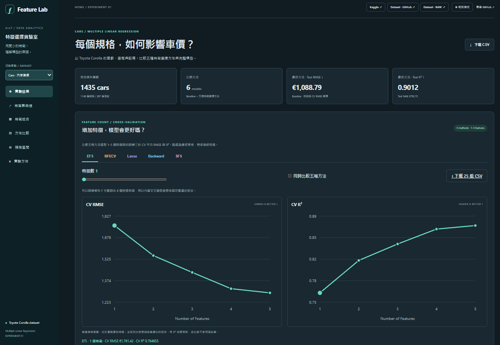
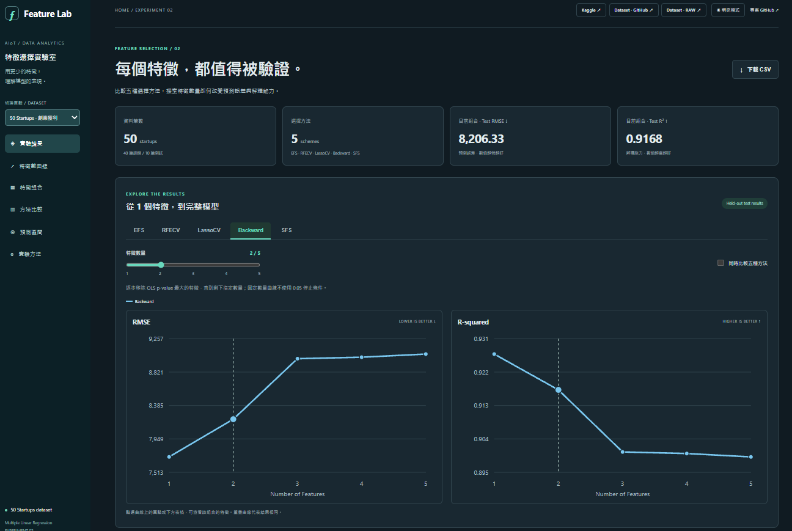
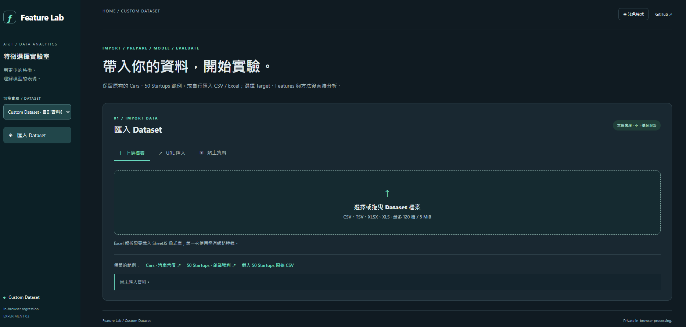
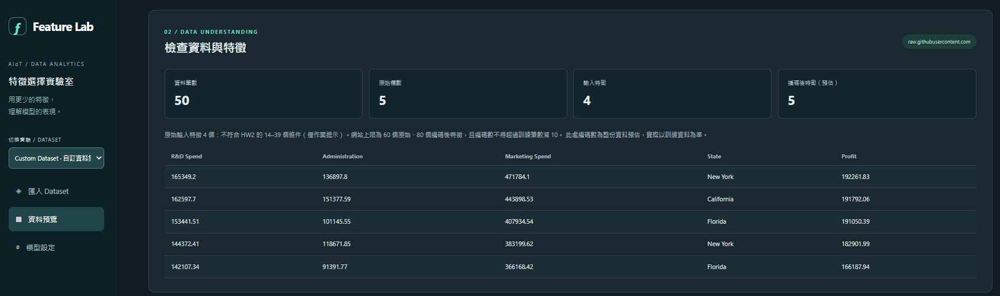
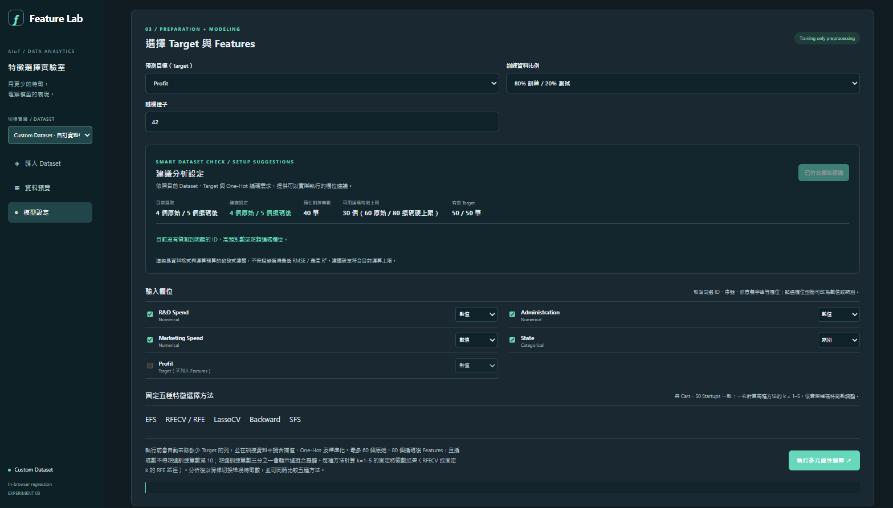
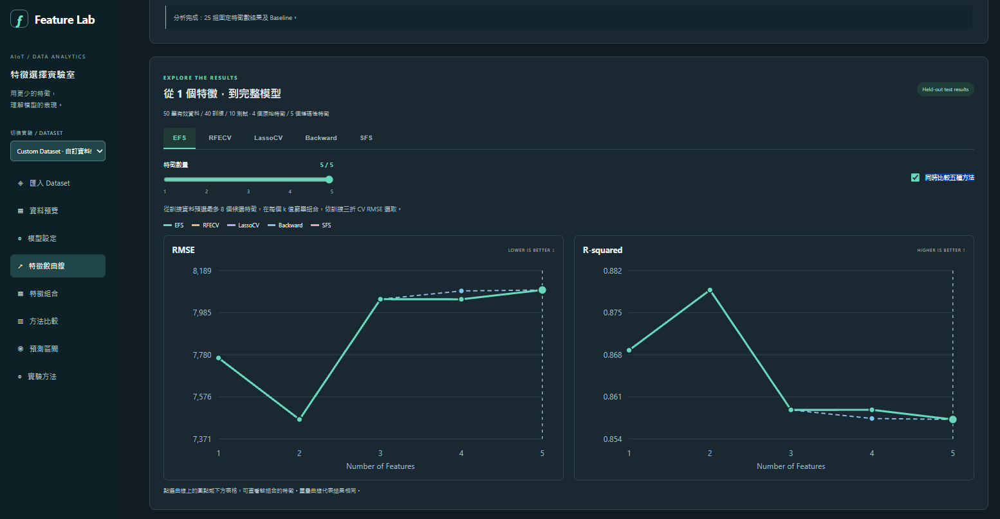
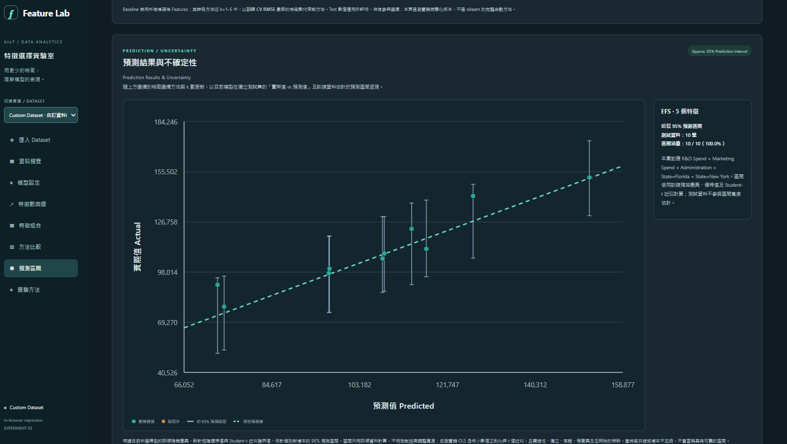

# Feature Lab｜特徵選擇實驗室

> **每個特徵，都值得被驗證。**  
> *Feature Selection · Multiple Linear Regression · Model Evaluation · Prediction Uncertainty*

Feature Lab 是依照 **CRISP-DM** 建構的互動式線性迴歸實驗網站，核心問題是：「**在降低特徵數量與模型複雜度的同時，能否維持良好的預測能力？**」網站提供兩個公開資料集實驗，以及一套可自行匯入資料、執行特徵選擇與比較預測結果的瀏覽器工具。

[**Live Demo — Cars**](https://cg3599.github.io/20261014-hw2-Multiple-Linear-regression/) · [**Live Demo — 50 Startups**](https://cg3599.github.io/20261014-hw2-Multiple-Linear-regression/startups.html) · [**Live Demo — Custom Dataset**](https://cg3599.github.io/20261014-hw2-Multiple-Linear-regression/custom.html)

## 目錄

- [Live Demo 與三個頁面](#live-demo-與三個頁面)
- [頁面預覽：Cars + 50 Startups + Custom Dataset 五步驟](#頁面預覽cars--50-startups--custom-dataset-五步驟)
- [技術架構與資料處理流程](#技術架構與資料處理流程)
- [線性迴歸與模型評估原則](#線性迴歸與模型評估原則)
- [五種特徵選擇方法](#五種特徵選擇方法)
- [實驗一：Cars — Toyota Corolla](#實驗一cars--toyota-corolla)
- [實驗二：50 Startups](#實驗二50-startups)
- [實驗三：Custom Dataset](#實驗三custom-dataset)
- [預測區間與不確定性](#預測區間與不確定性)
- [CRISP-DM 六階段](#crisp-dm-六階段)
- [重現方式、目錄與限制](#重現方式目錄與限制)

## Live Demo 與三個頁面

| 頁面 | Live Demo | 主要任務 | 模型執行環境 |
| --- | --- | --- | --- |
| **Cars（首頁）** | [開啟 Cars](https://cg3599.github.io/20261014-hw2-Multiple-Linear-regression/) | 使用 Toyota Corolla 的規格預測車價，分析大量特徵的取捨 | Python / scikit-learn **離線訓練**；網頁展示匯出結果 |
| **50 Startups** | [開啟 50 Startups](https://cg3599.github.io/20261014-hw2-Multiple-Linear-regression/startups.html) | 以研發、管理、行銷費用及地區預測企業獲利 | Python / scikit-learn **離線訓練**；網頁展示匯出結果 |
| **Custom Dataset** | [開啟自訂實驗室](https://cg3599.github.io/20261014-hw2-Multiple-Linear-regression/custom.html) | 匯入自有 CSV／Excel／RAW URL、選 Target 與 Features，立即分析 | **瀏覽器內 JavaScript** 模型與互動圖表 |

三頁共用深色／明亮主題、資料集切換選單、方法比較版型和 **「實際值 vs. 預測值 + 95% 預測區間」**。GitHub Pages 採靜態部署，無需替網站架設 Python 後端。

## 頁面預覽：Cars + 50 Startups + Custom Dataset 五步驟

以下 **7 張圖片均為實際網站畫面截圖**：Cars 與 50 Startups 各提供一張實驗首頁總覽，Custom Dataset 以五個畫面呈現完整工作流程。

### Cars｜汽車售價特徵選擇



**畫面重點：** 1,435 筆有效資料、6 種模型（Baseline + 5 種方法）、特徵數滑桿、五方法疊圖、CV RMSE／R² 與訓練 CV 選出的最佳方法。

### 50 Startups｜創業獲利特徵選擇



**畫面重點：** 以 50 筆創業公司資料分析 `Profit`，使用 **4 個原始特徵**（R&D Spend、Administration、Marketing Spend、State），One-Hot 編碼後共有 **5 個特徵**；可比較 EFS、RFECV、LassoCV、Backward 與 SFS 的特徵組合、RMSE 和 R²。**截圖示範的是 Backward、k=2 的指定組合**，顯示 Test RMSE **8,206.33**、Test R² **0.9168**；這是目前畫面的選取狀態，並非「原始自動選擇」的最佳特徵數。

**[開啟 50 Startups Live Demo](https://cg3599.github.io/20261014-hw2-Multiple-Linear-regression/startups.html)**

### Custom Dataset｜完整操作流程

**01｜匯入 Dataset** — 上傳 CSV／TSV／Excel、輸入公開 RAW CSV 網址或貼上表格資料。資料匯入成功後，自動捲動至資料檢查區。



**02｜檢查資料與特徵** — 預覽資料列、原始欄位與編碼後欄位預估數，確認 Target 與特徵是否合理。



**03｜模型設定與特徵篩選建議** — 設定 Target、訓練／測試比例、隨機種子，檢視自動排除 ID、高基數類別與缺失過多欄位的建議；仍可手動調整。



**04｜執行多元線性迴歸與比較** — 執行 Baseline 與 EFS、RFECV/RFE、LassoCV、Backward、SFS，在指定特徵數下檢視 RMSE／R² 曲線與各方法特徵組合。



**05｜預測結果與不確定性** — 觀察實際值 vs. 預測值散點圖、理想預測線與近似 95% 個別預測區間；方法與特徵數變更時同步更新。



> **階段式導覽：** 尚未匯入資料時，只顯示「匯入 Dataset」；匯入後顯示「資料預覽／模型設定」；成功完成模型分析後，才開放特徵曲線、特徵組合、方法比較、預測區間與 CRISP-DM。修改設定使結果失效時，分析選單會再次隱藏。

## 技術架構與資料處理流程

| 層級 | 技術／套件 | 用途 |
| --- | --- | --- |
| 資料處理與正式實驗 | **Python、pandas、NumPy** | 清理 CSV、數值處理、資料切分與統計計算 |
| 模型與特徵選擇 | **scikit-learn** | `LinearRegression`、`Pipeline`、`ColumnTransformer`、`OneHotEncoder`、`RFECV`、`LassoCV` 等 |
| 統計檢定／Backward | **statsmodels** | OLS、p-value 型 Backward Elimination（Python 範例） |
| 實驗圖與結果匯出 | **Matplotlib、JSON／JavaScript、CSV、joblib** | 離線產生分析圖與預測結果，供靜態網頁展示 |
| 網站介面 | **HTML、CSS、原生 JavaScript、SVG** | 深淺色主題、特徵曲線、可展開特徵清單、預測區間視覺化 |
| 自訂資料匯入 | **File API、Fetch API、SheetJS** | 上傳 CSV／TSV／Excel、匯入公開 RAW 網址與貼上表格；Excel 解析需要載入外部函式庫 |
| 部署／版本控制 | **GitHub、GitHub Pages** | 以 `main` 分支的 `/docs` 提供 Live Demo；README 與程式版本同步管理 |

**兩條實作路徑：**

```text
Cars / 50 Startups（Python 預先計算）
公開 CSV → 清理與切分 → sklearn Pipeline → 五方法特徵選擇
         → 訓練 CV 選擇模型 → 保留測試集評估 → 匯出 JS/CSV → GitHub Pages

Custom Dataset（瀏覽器即時運算）
檔案 / RAW URL / 貼上 → Target & Features 設定 → 訓練集補值、編碼、標準化
         → Baseline + 五種固定 k 選法 → 訓練 CV / 保留測試集
         → SVG 圖表、方法比較、近似預測區間、CSV 匯出
```

## 線性迴歸與模型評估原則

### 1. 迴歸模型如何預測？

本專案以**多元線性迴歸（Multiple Linear Regression）**為共同的最終預測器，假設目標值能由選定特徵的線性組合近似：

$\n\hat{y} = \beta_0 + \beta_1 x_1 + \cdots + \beta_k x_k\n$

- **Cars Target：** `price`（單位 EUR），輸入例如 `age_08_04`、`km`、`weight`、`hp` 等汽車特徵。
- **50 Startups Target：** `Profit`，輸入如 `R&D Spend`、`Administration`、`Marketing Spend`、`State`。
- **Custom Target：** 由使用者自行選擇**數值型**目標欄位。

EFS、RFECV/RFE、Lasso、Backward、SFS 是**決定留下哪些輸入特徵的程序**；最終比較的預測模型仍以線性迴歸擬合。Lasso 的 L1 正則化也被用於特徵重要性判定。

### 2. 為什麼要做 Feature Selection？

同時考慮 **預測誤差（RMSE）**、**解釋能力（R²）**、**特徵數**、**模型複雜度**及**計算成本**。加入更多欄位不保證泛化能力提升，過多欄位也可能造成共線性、雜訊與過擬合。評估特徵價值時，應以訓練資料內的交叉驗證為主要選擇依據，而不是反覆查看測試成績挑模型。

### 3. 資料切分、CV 與測試集的分工

1. **Data Preparation：** 缺失值補齊、類別 One-Hot Encoding、必要時標準化；避免 Dummy Variable Trap，對有截距項的模型省略一個類別基準欄。
2. **Train/Test Split：** 使用訓練資料進行擬合、特徵選取與調參，保留測試資料評估最終表現。
3. **Cross-Validation：** 主要以 **CV RMSE（越小越好）** 比較候選方法及特徵組合；CV R² 提供額外參考。
4. **Model Evaluation：** 使用 **RMSE、MAE、R²**；RMSE 對較大誤差較敏感，MAE 是平均絕對誤差，R² 衡量相對於目標平均值基準的解釋能力。
5. **Prediction Interval：** 額外估計單筆新觀測的不確定性，而不只是提供一個點預測。

**重要區別：** Cars 的固定 k 曲線是**訓練三折 CV** 指標；50 Startups 與 Custom Dataset 的固定 k 曲線是**保留測試集**指標。三頁曲線的評估來源**不完全相同**，不可直接把曲線數值當作同一個公平排名；正式選模型仍應以訓練 CV 為準。

## 五種特徵選擇方法

| 方法 | 英文名稱 | 基本原則 | 適用情境與注意事項 |
| --- | --- | --- | --- |
| **EFS** | Exhaustive Feature Selection | 窮舉候選特徵子集合，逐一計算 CV 誤差後選較佳組合 | 小候選集較精確，但組合數隨欄位數快速增加 |
| **RFECV / RFE** | Recursive Feature Elimination with Cross-Validation | 先用模型估計重要性、移除較弱特徵；RFECV 再利用 CV 決定保留數量 | RFE 固定 k 與 RFECV 自動選 k **是兩種不同設定** |
| **Lasso / LassoCV** | Least Absolute Shrinkage and Selection Operator | L1 正則化使部分係數變成 0 或接近 0，再選擇具代表性的特徵 | 係數受量綱影響，通常先標準化；LassoCV 用 CV 選懲罰強度 |
| **Backward** | Backward Elimination | 從較完整特徵集合開始，反覆刪除符合移除規則的特徵 | Python 範例依 OLS **p-value**；Custom 簡化版依**係數絕對值**，不能視為相同方法 |
| **SFS** | Sequential Forward Selection | 從空集合開始，每輪加入對 CV RMSE 改善較有幫助的特徵 | 比全面窮舉省運算，但貪婪式搜尋可能錯過全域最佳組合 |

### 三頁的實際特徵選擇設定

| 方法 | Cars：Python 正式實驗 | 50 Startups：Python 正式實驗 | Custom：JavaScript 即時實驗 |
| --- | --- | --- | --- |
| EFS | 依 F-score 預選 8 個候選，窮舉 **1–3 個**特徵，以內層 3 折 CV RMSE 比較 | 從編碼後 5 個特徵中窮舉子集合，CV 決定組合 | 先挑最多 **8 個候選**，固定每個 k=1–5 窮舉，依訓練三折 CV RMSE 選擇 |
| RFECV／RFE | 標準化後遞迴移除（step=3、min=2），內層 CV 決定保留數量 | 原始比較使用 RFECV；固定 k 曲線是 RFE 消除路徑 | 最多 **15 個候選**；固定 k 用係數大小逐步移除，**非**完整自動 RFECV |
| LassoCV | 標準化 LassoCV 選非零係數，再由 LinearRegression 重擬合 | 使用 LassoCV 特徵選擇／固定 k 係數排序 | 簡化版 L1 係數比較懲罰強度，選出固定 k 後以線性迴歸重擬合 |
| Backward | 從完整集合反覆移除最大 p-value，直到皆 ≤ 0.05 或僅剩一項 | Python 使用 Backward 規則比較 | 最多 **18 個候選**，依線性迴歸係數絕對值逐步刪減至 k，**不使用 p-value** |
| SFS | 依 F-score 預選 15 個候選，以內層 3 折 CV 向前選取 8 個 | CV 驅動前向選取 | 最多 **12 個候選**；每輪新增使三折 CV RMSE 最佳的欄位 |

> 表中 **Baseline** 指「不執行特徵刪減的完整線性模型」，用來對照五種 Feature Selection 方法。Cars、50 Startups 的方法比較表是各方法原始自動／既定規則的輸出；Custom 則從固定 k=1–5 的結果中，以**訓練 CV RMSE 最低**者代表該方法，**不是 sklearn 原生的自動選特徵數**。

## 實驗一：Cars — Toyota Corolla

### 資料來源與問題定義

- **Kaggle：** [Price of Used Toyota Corolla Cars](https://www.kaggle.com/datasets/vishakhdapat/price-of-used-toyota-corolla-cars)
- **GitHub Dataset：** [ToyotaCorolla.csv](https://github.com/reisanar/datasets/blob/master/ToyotaCorolla.csv)
- **RAW CSV：** [直接開啟原始資料](https://raw.githubusercontent.com/reisanar/datasets/refs/heads/master/ToyotaCorolla.csv)
- **Target：** 二手車售價 `price`（EUR）。

| 資料與實驗設定 | 結果 |
| --- | ---: |
| 原始資料 | **1,436 筆** |
| 去重後有效資料 | **1,435 筆** |
| 原始輸入 Features | **33 個**（31 個數值、2 個類別） |
| One-Hot 等前處理後完整 Features | **42 個** |
| 訓練／測試 | **1,148／287 筆** |
| 訓練 CV | **3 折**，`random_state=42` |

**前處理：** 排除 `model`、常數欄 `cylinders`、與車齡重複的 `mfg_month`／`mfg_year`；數值與類別缺失分別使用中位數、眾數；`cc`、`weight`、`hp` 根據訓練折分位數作 0.5%–99.5% 截尾；類別 `fuel_type`、`color` 使用 One-Hot。相關前處理放在 scikit-learn Pipeline 中，外層 CV 各折重新擬合。

### 五方法與 Baseline：原始設定結果

以**訓練 CV RMSE** 由低至高排序：

| 方法 | 選取的編碼後特徵數 | CV RMSE ↓ | 設定說明 |
| --- | ---: | ---: | --- |
| **Baseline** | **42** | **€1,191.06** | 完整特徵集合，訓練 CV 最佳 |
| RFECV | 42 | €1,197.12 | RFECV 遞迴選擇 |
| Lasso | 40 | €1,199.55 | L1 特徵稀疏化 |
| Backward | 21 | €1,211.20 | OLS p-value 排除 |
| SFS | 8 | €1,269.24 | 循序向前選取 |
| EFS | 3 | €1,433.01 | 小型候選集合的窮舉 |

**最終測試結果：** 由訓練 CV 選出的 **Baseline**，Test **RMSE = €1,088.79**、**MAE = €792.72**、**R² = 0.9012**。網站並未為其他五種方法儲存相同獨立測試集的個別 Test 分數，因此相應欄位顯示 `—`，不以 CV 代替 Test。

**研究解讀：** 原始設定下 Baseline 有最低的 CV RMSE；但 Backward、SFS 與 EFS 以較少特徵換取更簡單的模型，說明這是一個**誤差、解釋性與特徵成本的取捨**，而非只追求特徵數越少越好。

## 實驗二：50 Startups

### 資料來源與目標

- **Kaggle：** [50 Startups](https://www.kaggle.com/datasets/abhishek14398/50startups)
- **GitHub Dataset：** [50_Startups.csv](https://github.com/Avik-Jain/100-Days-Of-ML-Code/blob/master/datasets/50_Startups.csv)
- **RAW CSV：** [直接開啟原始資料](https://raw.githubusercontent.com/Avik-Jain/100-Days-Of-ML-Code/refs/heads/master/datasets/50_Startups.csv)
- **Target：** `Profit`。

資料包含 **50 筆紀錄**、**4 個原始輸入特徵**（`R&D Spend`、`Administration`、`Marketing Spend`、`State`）；`State` 做 One-Hot 並移除基準欄後，變成 **5 個編碼特徵**。使用 `random_state=42` 切為 **40 筆訓練／10 筆測試**；Python 範例定義內層 4 折、外層 5 折 CV。頁面除了五方法的固定 k=1–5 曲線，也保留原始自動方法比較。

| 方法 | 選取特徵數 | CV RMSE ↓ | Test RMSE ↓ | Test R² ↑ |
| --- | ---: | ---: | ---: | ---: |
| **Backward** | **1** | **9,744.13** | **7,714.33** | **0.9265** |
| LassoCV | 2 | 9,764.07 | 8,206.33 | 0.9168 |
| SFS | 2 | 9,866.29 | 9,152.27 | 0.8966 |
| EFS | 2 | 9,866.29 | 9,152.27 | 0.8966 |
| Baseline | 5 | 9,994.28 | 9,055.96 | 0.8987 |
| RFECV | 4 | 10,399.10 | 9,316.54 | 0.8928 |

**結果：** 這次切分中，Backward 以單一 **`R&D Spend`** 特徵取得最低訓練 CV RMSE，也有最佳展示的 Test RMSE。這是特定資料與隨機切分下的結果，**不表示其他資料集也只需要一個特徵**。

> **作業要求補充：** 50 Startups 原始特徵僅有 4 個，不符合「資料集需超過 13 個原始 Features」的獨立門檻。若作業要求擇一具有大於 13 個特徵的資料集，應以 **Cars（33 個原始 Features）作為正式繳交案例**，將 50 Startups 當作對照實驗。

## 實驗三：Custom Dataset

### 使用方式

1. **匯入：** 上傳 CSV／TSV／Excel（XLSX、XLS）、貼上 CSV／Excel 表格，或輸入可供瀏覽器讀取的公開 CSV／TSV **RAW URL**。GitHub 的 `/blob/` 檔案頁及 Kaggle 介紹頁不是直接資料網址。
2. **預覽：** 匯入成功後，頁面自動捲動到「檢查資料與特徵」，顯示資料量、欄位數、前五列及編碼後特徵預估。
3. **設定：** 自訂數值型 Target、Features、欄位型態、訓練比例（70/30、80/20、90/10）與隨機種子。
4. **檢查建議：** 提示疑似 ID、常數特徵、缺失達 50% 的欄、高基數類別與編碼成本，必要時可套用建議排除欄位；**使用者仍保有最終選擇權**。
5. **分析：** 以 JavaScript 計算 Baseline 及五方法 × k=1–5（若可用編碼特徵少於 5，則只計算可行的 k）；依訓練 CV RMSE 選出各方法代表組合。
6. **解讀與匯出：** 五方法 RMSE／R² 曲線與疊圖、選取特徵清單、Test RMSE／Test R²、預測散點圖及近似 95% 預測區間，並可下載 CSV。

**資料與運算上限：**

| 項目 | 規則 |
| --- | --- |
| 檔案大小 | **最多 5 MiB** |
| 原始 CSV 欄位 | **最多 120 欄** |
| 分析可用資料 | **最多 3,000 筆有效紀錄** |
| 使用者勾選的原始 Features | **最多 60 個** |
| One-Hot 後 Features | **最多 80 個，且 ≤ 訓練筆數 − 10** |
| 類別欄位基數 | **單欄不超過 12 個類別** |
| CV／方法比較 | **訓練集 3 折 CV**；五方法固定 k=1–5 |
| 過擬合提醒 | 編碼後特徵數超過訓練資料約 **1/3** 時提示風險 |

數值缺失依訓練集統計補齊並做尺度調整；類別使用訓練集決定類別集合、補值與移除基準類別的 One-Hot。分析資料**不會傳到本專案的伺服器**；若使用 URL 匯入，瀏覽器仍會直接向該公開網址請求資料；Excel 需要外部 SheetJS 函式庫。

### Custom 的方法實作不等同 sklearn

Custom 為降低瀏覽器運算量而做了**候選數量限制與演算法簡化**。其中 RFECV 名稱對應固定 k 的 RFE 消除路徑，Backward 不以 statsmodels 的 p-value 為準，LassoCV 亦非直接呼叫 sklearn。本頁固定 k 組合的**特徵選取依據為訓練 CV**；上方曲線顯示同一保留測試集上的 Test RMSE／R²，**不應以 Test 分數挑模型**。

瀏覽器版本在部分內層 CV 折次重用已由整體訓練集擬合的編碼與前處理統計，可能使 CV 指標略顯樂觀；若需要發表等級的嚴格公平比較，建議將選取、補值、編碼與標準化封裝為 **sklearn Pipeline**，在各 CV 訓練折內重新擬合，必要時使用完整 Nested CV。

## 預測區間與不確定性

三個頁面均呈現 **Actual vs Predicted** 散點圖：橫軸為預測值、縱軸為實際值，虛線代表理想的 `Actual = Predicted`。每個誤差棒表示**對個別新觀測值的 95% 預測區間（Prediction Interval）**，不同於「平均預測值的 95% 信賴區間」。

| 頁面 | 預測區間方法 | 使用的資料與已知限制 |
| --- | --- | --- |
| **Cars** | **Split Conformal Prediction** | 將既有 287 筆測試預測拆成 **143 筆校準**與 **144 筆展示**；由校準絕對殘差的有限樣本分位數求區間寬度，展示集實測涵蓋 **138/144 ≈ 95.8%**。在交換性假設下為*邊際*涵蓋保證；原 Test RMSE／R² 仍基於原 287 筆資料 |
| **50 Startups** | **參數式 OLS Student-t 個別預測區間** | 原始 40 筆訓練／10 筆測試；對訓練 CV 選出的 Backward（`R&D Spend`）以殘差變異、槓桿值與 `df=38` 的 t 臨界值計算；需線性、獨立、常態、等變異誤差等假設 |
| **Custom Dataset** | **近似 OLS Student-t 預測區間** | 隨方法與 k 即時更新，由訓練殘差變異及設計矩陣槓桿值估計；使用數值穩定修正及 t 臨界值近似，不保證分布無關覆蓋率，資料不足或矩陣不可逆則提示無法估計 |

圖中綠點表示實際值落在預測區間內，橘點表示落在區間外；**實測涵蓋率不等於對所有未來資料的保證**。若點數較多，圖表會抽樣顯示誤差棒以避免重疊，涵蓋率統計仍採完整展示樣本。

## CRISP-DM 六階段

| 階段 | 網站中的具體實作 |
| --- | --- |
| **1. Business Understanding** | 定義預測任務：二手車售價、創業獲利或使用者自訂 Target；衡量特徵簡化的價值 |
| **2. Data Understanding** | 檢視紀錄數、欄位、數值／類別、缺失狀況與資料來源 |
| **3. Data Preparation** | 清理、去重、訓練測試分割、補值、One-Hot、標準化與候選特徵篩選 |
| **4. Modeling** | Baseline 多元線性迴歸，搭配 EFS、RFECV/RFE、Lasso、Backward、SFS |
| **5. Evaluation** | CV RMSE／R²、Test RMSE／MAE／R²、特徵數和預測區間，避免利用 Test 挑模型 |
| **6. Deployment** | Python 離線匯出結果、Custom 前端即時計算，GitHub Pages 發布與 README／CSV 供重現 |

Cars 與 50 Startups 使用已寫好的靜態六階段說明；Custom 依當次 Dataset、Target、Features、分割設定與模型評估動態呈現六階段內容。

## 重現方式、目錄與限制

### 網站本機預覽

```bash
git clone https://github.com/CG3599/20261014-hw2-Multiple-Linear-regression.git
cd 20261014-hw2-Multiple-Linear-regression
python -m http.server 8000 --directory docs
```

開啟 <http://localhost:8000/>。Custom Dataset 的一般 CSV 與模型分析在瀏覽器內完成；若開啟 Excel 需要外部 SheetJS 套件，匯入 RAW URL 則受 CORS 限制。

### Python 實驗重現

```bash
pip install -r requirements.txt
python main.py     # 50 Startups；使用專案根目錄的 50_Startups.csv
python main5.py    # Cars；需要先放置 ToyotaCorolla.csv（見下）
```

**Cars 路徑注意：** `main5.py` 現有程式碼使用 `PROJECT_ROOT.parent / "ToyotaCorolla.csv"`，也就是 **GitHub 專案資料夾的上一層**。重跑前請先從上述 RAW CSV 下載至該位置；程式若找不到檔案會報錯。此說明保留程式目前的真實讀取位置，不假設 CSV 已包含在 repository 根目錄。已匯出的示例數據可直接透過 Live Demo 檢視，不需重新訓練。

### 主要檔案結構

```text
README.md
main.py                         # 50 Startups / sklearn
main5.py                        # Toyota Corolla / sklearn
requirements.txt                # Python 依賴
50_Startups.csv
assets/readme/                  # 本 README 六張網站畫面截圖
  cars-overview.png
  custom-import.png
  custom-preview.png
  custom-config.png
  custom-curves.png
  custom-prediction-interval.png
docs/
  index.html                    # Cars 首頁
  startups.html                 # 50 Startups
  custom.html                   # 自訂 Dataset
  data.js / cars-data.js        # Python 實驗結果
  startups-prediction-data.js   # 50 Startups 預測區間
  cars-curves-data.js           # Cars 固定 k 實驗結果
  custom-model.js               # JavaScript OLS、特徵選擇與區間
  custom-advisor.js             # 欄位檢查與建議
  custom.js / custom-curves.js  # 匯入、互動與圖表
  method-comparison.js          # 三頁共用方法比較表
  prediction-uncertainty.js     # 三頁共用預測圖
  pages.js / pages.css          # 導覽／視覺樣式
  style.css / theme.css / custom.css
results/                         # CSV、圖表與實驗匯出資料
tests/                           # Node.js 結構與模型檢查
```

### 建議的檢查指令

```bash
node tests/custom-model.test.cjs
node tests/custom-advisor.test.cjs
node tests/method-comparison.test.cjs
node tests/prediction-uncertainty.test.cjs
```

### 評估與研究限制

- **不同資料集的 RMSE 不可直接比較**：Cars 與 Startups 的預測目標、數值尺度與實驗設定不同。
- **50 Startups 是對照範例**：原始 Features 未超過 13；需要符合課堂「>13 Features」門檻時，正式案例請採 Cars。
- **CV 與 Test 應分開解讀**：Cars 的 Test 分數僅為最終 Baseline 已匯出數值；不要把其餘方法的 CV RMSE 誤寫為 Test RMSE。
- **Custom 是 JavaScript 教學／互動實作**，演算法、候選限制與 CV 前處理細節皆可能不同於完整 sklearn Pipeline；不宜將三頁的「同名方法」視為逐步完全等價。
- **95% 預測區間具有前提條件**：對誤差結構或可交換性等假設的依賴，應與實驗結果一併說明。

---

**Feature Lab｜以更少的特徵，理解模型的表現。**  
[Live Demo](https://cg3599.github.io/20261014-hw2-Multiple-Linear-regression/) · [原始程式碼](https://github.com/CG3599/20261014-hw2-Multiple-Linear-regression)
